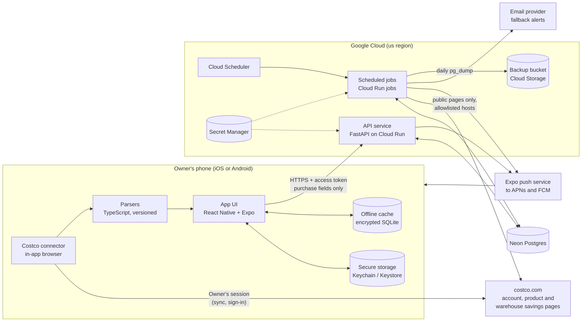
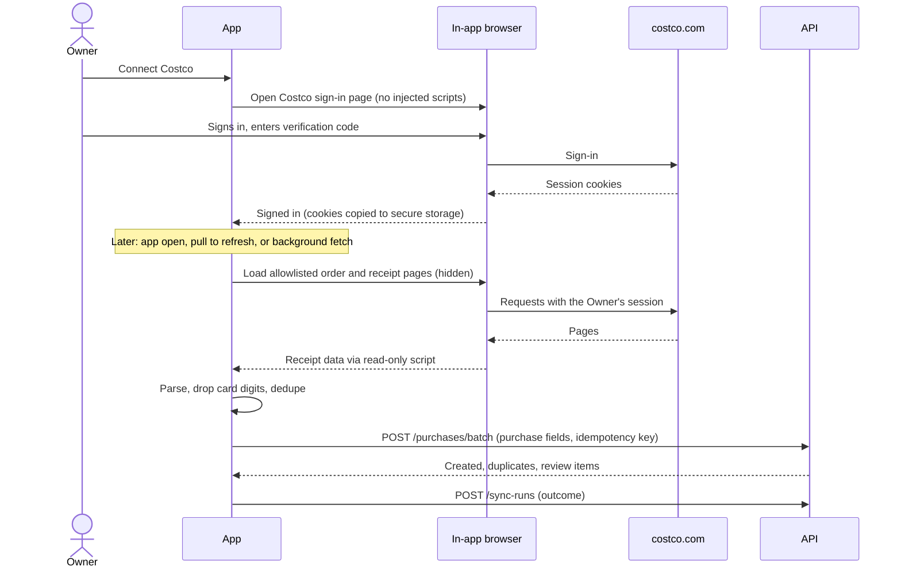
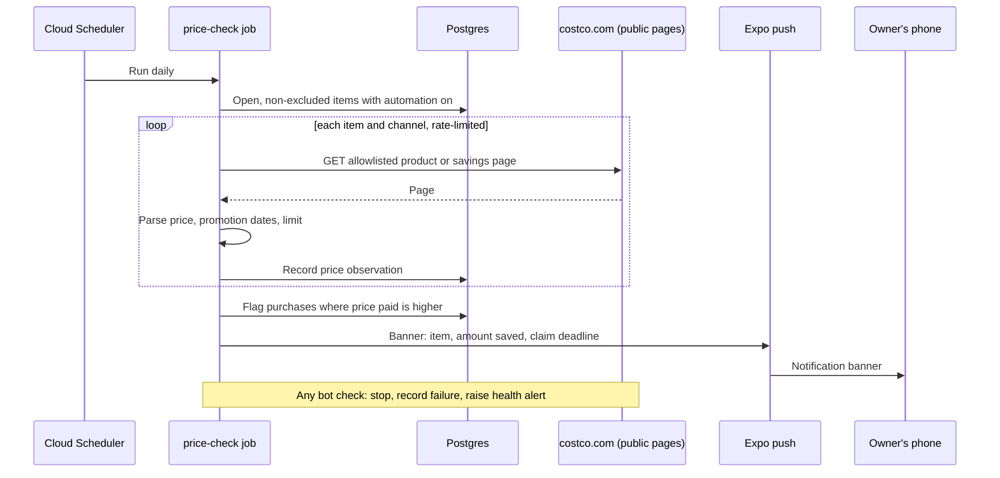

# Costco Price Match App — System Architecture

**Status:** Draft for review · **Phase:** 3, Design · **Last updated:** Oct 21, 2026

## 1. Overview

This document describes how the Phase 1 MVP in the [requirements specification](../requirements.md) is built. It covers the system's parts, how data moves between them, the API, configuration, deployment, and the work still to confirm before implementation. The key choices are recorded as [architecture decision records](../adr/README.md):

- **App:** React Native with Expo, in TypeScript, for iOS and Android ([ADR 0001](../adr/0001-mobile-framework-react-native-expo.md))
- **Backend:** FastAPI in Python ([ADR 0002](../adr/0002-backend-fastapi.md))
- **Hosting:** Google Cloud Run for the API and scheduled jobs, Neon for Postgres ([ADR 0003](../adr/0003-hosting-cloud-run-neon.md))
- **Price checks:** a daily job on the server ([ADR 0004](../adr/0004-server-side-price-checks.md))
- **Parsing:** Costco account pages and receipt PDFs are parsed on the phone, so only purchase fields reach the server ([ADR 0005](../adr/0005-parse-costco-documents-on-device.md))

The companion documents are the [data model](data-model.md) and the [threat model](threat-model.md).

**Design principles**

1. **The Costco session never leaves the phone.** The server can't sign in to Costco and never holds anything that could.
2. **Minimum data on the server.** Only the purchase fields in FR-04 are uploaded; raw pages and PDFs stay on the phone.
3. **Every automated source has a manual fallback.** Sync, price checks and push each have a path the Owner controls.
4. **Business rules are pure code plus configuration.** Windows, deadlines, comparisons and claim amounts live in one package with no web or database imports.
5. **Personal-use automation only.** Automated sources are off for every account except the Owner's (FR-31), at personal-use rates, and stop at any bot check (NFR-21).

## 2. System context



Trust boundaries sit between the phone and Costco, the phone and the API, the backend and Costco, and the backend and each third-party service. The [threat model](threat-model.md) walks through each one.

## 3. Components

### 3.1 Mobile app

| Module | Responsibility | Requirements |
| --- | --- | --- |
| Screens | Home (open windows, price drops, health banners), purchase detail, claim card, manual purchase and price forms, review queue, savings log, settings and Costco connection | FR-07, FR-10, FR-15, FR-17, FR-22, FR-25 |
| Costco connector | Shows Costco's sign-in page in a visible WebView with no injected scripts; afterwards runs sync in a hidden WebView on allowlisted order and receipt pages only; reports each run's outcome to the API | FR-01, FR-03, FR-21, NFR-21 |
| PDF reader | Receives PDFs from the share sheet and file picker; extracts text in a hidden, network-blocked WebView running bundled PDF.js; enforces 5 MB, 10 pages and 10 seconds | FR-06, NFR-05 |
| Parsers | Versioned TypeScript parsers turn page data and PDF text into purchases (FR-04 fields), apply discount lines and drop card digits; failures become review items | FR-04, FR-05, FR-09, NFR-03, NFR-23 |
| Sync engine | Runs sync on open, pull to refresh, and background fetch; deduplicates before upload; rate-limits to one sync an hour; uploads in idempotent batches | FR-03, FR-08, NFR-16, NFR-17 |
| Secure storage | Holds the app's refresh token and the Costco session cookies in `expo-secure-store`; holds the cache encryption key | FR-30, NFR-02, NFR-08 |
| Offline cache | Encrypted SQLite copy of open purchases, flags and claim cards for use without a connection | FR-23, NFR-11 |
| Notifications | Requests permission, registers the Expo push token, routes a tapped banner to the claim card, sets the app icon badge | FR-19, FR-29 |
| API client | TypeScript client generated from the API's OpenAPI document; refreshes access tokens | FR-27 |

### 3.2 Backend API (Cloud Run service)

A stateless FastAPI app. Every route except sign-in and refresh requires a valid access token, and every query filters by the signed-in user's ID through one shared data-access layer (FR-27, FR-28, NFR-10).

| Package | Responsibility |
| --- | --- |
| `auth` | Sign-in with Argon2id password hashes, 15-minute access tokens, rotating refresh tokens stored as hashes, lockout after 5 failures in 15 minutes (FR-26, NFR-08, NFR-09) |
| `domain` | Pure business rules: last eligible date, claim deadline, same-channel comparison, exclusions matching, refund due with quantity limits, claim status transitions (FR-12 to FR-14, FR-18, FR-24, BR-1 to BR-9) |
| `purchases`, `prices`, `flags`, `claims`, `review` | REST routes and data access for each resource |
| `notify` | Sends through the Expo push service; falls back to email when push is off or a push receipt reports the device unreachable (FR-19) |
| `config` | Loads rules and limits from environment and the exclusions table (NFR-22) |

### 3.3 Scheduled jobs (Cloud Run jobs)

| Job | Schedule (owner's time zone) | What it does | Requirements |
| --- | --- | --- | --- |
| `price-check` | Daily, 6:00 | Collects distinct item numbers and channels across open, non-excluded purchases of accounts with automation on; fetches allowlisted product and in-warehouse savings pages at most once per item per day; records observations; runs flagging; sends alerts; stops and raises a health alert on any bot check | FR-16, FR-18, FR-19, FR-21, NFR-18, NFR-21 |
| `reminders` | Daily, 9:00 | Sends one window-closing digest per user, items not checked automatically first; catches up after a missed run | FR-20 |
| `health` | Daily, 9:05 | Flags accounts whose phone sync or price checks have failed past the threshold, or whose last successful sync is older than 24 hours while connected | FR-21, NFR-19 |
| `retention` | Daily, 3:00 | Expires purchases past their window; deletes stale review items and expired refresh tokens | FR-12, NFR-13 |
| `backup` | Daily, 2:00 | `pg_dump` to a Cloud Storage bucket with 30-day retention | NFR-20 |

### 3.4 Data stores

- **Neon Postgres:** all server data, described in the [data model](data-model.md). Encrypted at rest by the provider; TLS required for connections (NFR-11).
- **Cloud Storage bucket:** encrypted daily backups only; no user uploads.
- **Phone:** secure storage and the encrypted offline cache. Review-queue PDFs stay in the app's private storage until resolved or 30 days old.

### 3.5 External services

| Service | Used for | Data sent |
| --- | --- | --- |
| costco.com (from the phone) | Sign-in and receipt sync with the Owner's session | Whatever the Owner's own browser session would send |
| costco.com (from the server) | Public product and in-warehouse savings pages | Item numbers in URLs only; no session or user data |
| Expo push service, APNs, FCM | Notification banners | Push token, item description, amount saved, claim deadline (NFR-14) |
| Email provider (chosen in a spike) | Fallback alerts | The Owner's email address and the same minimal alert text |

## 4. Key flows

### 4.1 Connect Costco and sync receipts



### 4.2 Daily price check and alert



### 4.3 Claim at the counter

1. The Owner taps the banner, or opens the "Price drops" list; the flag is marked read.
2. The claim card loads from the API, or from the offline cache when the warehouse has no signal (FR-23).
3. The card shows item number, purchase date, price paid, current price, refund due (capped at any quantity limit), claim deadline, and the Returns counter of the purchase warehouse, or the "Request a Price Match" form for online orders (FR-22).
4. After the claim, the Owner marks it claimed, then refunded or denied; the savings log and alert accuracy update (FR-24, FR-25).

## 5. API

REST over HTTPS, JSON bodies, OpenAPI document generated by FastAPI. All routes except `/auth/login` and `/auth/refresh` need a bearer access token. Lists are paginated.

| Method and path | Purpose | FRs |
| --- | --- | --- |
| `POST /auth/login`, `POST /auth/refresh`, `POST /auth/logout` | Sign in, rotate tokens, revoke | FR-26, FR-27, FR-30 |
| `GET /me`, `PATCH /me` | Account settings (time zone, alert email); automation flag is read-only here | FR-31 |
| `POST /devices`, `DELETE /devices/{id}` | Register or remove a push token | FR-29 |
| `GET /purchases`, `POST /purchases` | List with filters; create a manual purchase | FR-07, FR-15 |
| `POST /purchases/batch` | Upload synced or PDF purchases with an idempotency key; returns created, duplicates and review items | FR-03, FR-06, FR-08, NFR-16 |
| `PATCH /purchases/{id}`, `DELETE /purchases/{id}` | Edit, exclude, or soft-delete | FR-11, FR-14 |
| `DELETE /purchases?source=sync` | Delete all synced purchases when disconnecting Costco | FR-02 |
| `GET /items/{item_number}/prices`, `POST /prices` | Price history; manual price entry | FR-17 |
| `GET /flags`, `PATCH /flags/{id}` | Price drops with unread state; mark read or move claim status | FR-19, FR-24 |
| `GET /flags/{id}/claim-card` | Claim card data | FR-22 |
| `GET /review-items`, `POST /review-items`, `PATCH /review-items/{id}` | Review queue | FR-09, FR-10 |
| `GET /savings` | Savings log, totals, alert accuracy | FR-25 |
| `POST /sync-runs`, `GET /health` | Phone reports sync outcomes; health banners | FR-21 |
| `GET /rules` | Window length, reminder lead time and exclusions, for display on the phone | NFR-22 |

## 6. Configuration

Values come from environment variables, with secrets from Secret Manager. The exclusions list lives in a database table seeded at deployment.

| Name | Default | Purpose |
| --- | --- | --- |
| `PRICE_ADJUSTMENT_WINDOW_DAYS` | 30 | BR-1 window length |
| `REMINDER_LEAD_DAYS` | 3 | Window-closing reminder lead time (FR-20) |
| `HEALTH_FAILURE_THRESHOLD` | 3 | Failed runs before a health alert (FR-21) |
| `SYNC_MIN_INTERVAL_MINUTES` | 60 | Minimum gap between syncs (NFR-21); enforced on the phone and checked by the API |
| `PRICE_CHECK_MAX_PER_ITEM_PER_DAY` | 1 | NFR-21 |
| `PRICE_CHECK_ALLOWED_HOSTS` | `www.costco.com` | Outbound host allowlist for the price checker |
| `ACCESS_TOKEN_TTL_MINUTES` / `REFRESH_TOKEN_TTL_DAYS` | 15 / 30 | NFR-08 |
| `DATABASE_URL`, `TOKEN_SIGNING_KEY`, `EXPO_ACCESS_TOKEN`, `EMAIL_API_KEY` | (secrets) | Secret Manager only (NFR-06) |

## 7. Deployment and operations

- **Environments:** `dev` (local Docker Compose with Postgres, and an Expo development build) and `prod` (Cloud Run and Neon). Neon branches give a throwaway database per pull request when needed.
- **CI (GitHub Actions) on every pull request:** lint and type checks, unit and fixture tests for both languages, coverage gate on the `domain` package (NFR-24), secret scanning (NFR-06), dependency vulnerability audit, and a fake-data check on fixtures (NFR-12).
- **CD on merge to `main`:** build the API container, run migrations, deploy to Cloud Run; app builds go through EAS Build to TestFlight and Google Play internal testing (NFR-30).
- **Observability:** structured JSON logs to Cloud Logging with a redaction filter for tokens, emails and receipt fields (NFR-13); job outcomes recorded in the database for health checks; a Google Cloud budget alert at $5 a month (NFR-28).

## 8. Repository layout

```text
app/                 Expo app (TypeScript)
  src/screens/
  src/costco/        connector, allowlist, parsers/v1/
  src/pdf/           PDF.js host page and reader
  src/api/           generated API client
  src/storage/       secure storage and offline cache
api/                 FastAPI backend (Python)
  app/auth/
  app/domain/        pure business rules
  app/routers/
  app/db/            models and Alembic migrations
  app/jobs/          price_check, reminders, health, retention, backup
  app/pricing/       fetcher, allowlist, parsers/v1/
  tests/fixtures/    invented data only
docs/
.github/workflows/
```

## 9. To confirm before implementation

These are short spikes at the start of Implementation. Each uses real pages or files inspected locally; nothing real is committed, and each ends with invented fixtures and a note in this document.

| Spike | Question | Blocks |
| --- | --- | --- |
| S-1 | Structure of the costco.com order and warehouse receipt pages: HTML or JSON loaded by the page, and the fields that identify a receipt (OQ-03) | Sync parser, duplicate key |
| S-2 | Does the in-warehouse savings listing change with the selected warehouse, and do its item numbers match receipts (OQ-05)? | Warehouse price checks |
| S-3 | Can the Costco app share a receipt PDF to another app on iOS and Android, and which Expo config plugin receives it (OQ-09)? | PDF fallback |
| S-4 | How often do iOS and Android actually run background fetch for this app (OQ-11)? | NFR-17 target |
| S-5 | Expo push service limits and receipts handling (OQ-10), and an email provider with a free tier inside NFR-28 | Notifications |
| S-6 | Can `expo-sqlite` encrypt the offline cache (SQLCipher) on both platforms, or is another encrypted store needed? | Offline cache |
