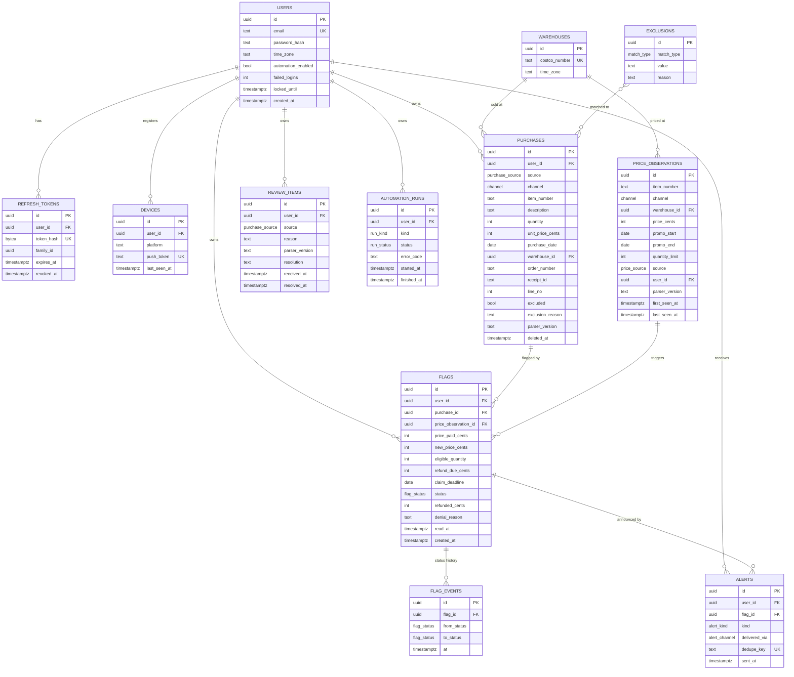

# Costco Price Match App — Data Model

**Status:** Draft for review · **Phase:** 3, Design · **Last updated:** Oct 21, 2026

This is the server-side data model in Neon Postgres, for the [architecture](architecture.md) and the [requirements](../requirements.md). The phone keeps an encrypted subset of it for offline use (section 4).

## 1. Conventions

- Primary keys are UUIDs (v7, so they sort by creation time).
- Money is stored as integer cents (`*_cents`), never as floats.
- Purchase and promotion dates are calendar dates (`date`) in the local time of the purchase warehouse, or the Owner's time zone for online orders (OQ-04). Event times are `timestamptz` in UTC.
- Every table holding user data has a non-null `user_id`, and every query filters on it (FR-28, NFR-10). Shared reference data (`warehouses`, `exclusions`, automatic `price_observations`) has no owner.
- Enumerations are Postgres enum types. Migrations are managed with Alembic.
- Nothing in this model stores a Costco password, the Costco session, payment card digits, or a membership number (NFR-01 to NFR-03).

## 2. Entity relationship diagram

## 3. Tables

### `users`

The single app account in Phase 1 (FR-26). `automation_enabled` defaults to `false` for every new account and is switched on only for the Owner in server configuration (FR-31). `failed_logins` and `locked_until` implement the lockout in NFR-09. `time_zone` is an IANA name used for online purchase dates and reminder timing.

### `refresh_tokens`

Only a SHA-256 hash of each refresh token is stored. Each refresh issues a new token in the same `family_id` and revokes the old one; if a revoked token is ever presented again, the whole family is revoked, which catches a stolen token being replayed (NFR-08).

### `devices`

Expo push tokens per phone (FR-29). Deleted on sign-out (FR-30) or when the push service reports the token invalid.

### `warehouses`

Public reference data: the Costco warehouse number printed on receipts and its time zone. No member data. Used for the claim card and for warehouse-specific prices if spike S-2 shows the savings listing differs by warehouse.

### `purchases`

One row per receipt line item (FR-04).

- `source` is `sync`, `pdf` or `manual`; `channel` is `warehouse` or `online` (FR-13).
- Duplicates are blocked by unique indexes: `(user_id, order_number, line_no)` for online orders and `(user_id, warehouse_id, receipt_id, line_no)` for warehouse receipts (FR-08). Manual entries are checked against `(user_id, item_number, purchase_date, unit_price_cents, channel)` in code, with a confirmation step instead of a hard block.
- `unit_price_cents` is after any discount or instant-savings line for that item (FR-05).
- Deletes are soft (`deleted_at`), so a later sync recognizes the line and doesn't re-create it (FR-11).
- The last eligible date is computed, not stored: `purchase_date + PRICE_ADJUSTMENT_WINDOW_DAYS`, inclusive (BR-1). A partial index on open, non-excluded, non-deleted rows keeps the daily jobs fast.

### `price_observations`

Each price seen, automatic or manual (FR-16, FR-17).

- Automatic observations are shared reference data (`user_id` null). Manual entries belong to the user who made them.
- Repeated checks with no change update `last_seen_at` instead of adding a row, which collapses history as US-PRC-03 requires.
- `promo_end` feeds the claim deadline (BR-5); `quantity_limit` caps the refund (BR-9). `warehouse_id` is set only if warehouse prices differ by location.

### `flags`

A price drop on one purchase, and the claim that follows (FR-18, FR-24).

- Values are frozen at flag time (`price_paid_cents`, `new_price_cents`, `eligible_quantity`, `refund_due_cents`) so the claim card matches what was alerted.
- `eligible_quantity = min(quantity, quantity_limit)` when a limit is known (BR-9); `refund_due_cents = (price_paid_cents − new_price_cents) × eligible_quantity`.
- `claim_deadline` is the earlier of the purchase's last eligible date and `promo_end` (BR-5).
- `status` follows flagged → claimed or dismissed; claimed → refunded or denied (BR-8). Each move is written to `flag_events`. A unique partial index allows only one open flag per purchase; a later, lower price replaces it and sends a new alert.
- `read_at` drives the unread badge (FR-19).

### `alerts`

A record of every notification sent, used for de-duplication (`dedupe_key`, for example `price_drop:<flag id>:<new price>`) and for the email fallback (FR-19, FR-20). Stores no message text beyond the kind.

### `review_items`

Imports that failed to parse (FR-09). The server stores only the reason, source and parser version; the PDF itself, if any, stays on the phone (ADR 0005).

### `automation_runs`

The outcome of each phone sync and each server price check, reported by the phone through `POST /sync-runs` or written by the job. The `health` job reads it to raise alerts when failures pass the threshold or a bot check appears (FR-21, NFR-19). `error_code` is a fixed vocabulary such as `session_expired`, `challenge`, `parse_error` or `network`, never page content.

### `exclusions`

Seeded configuration (NFR-22): `match_type` is `item_number`, `department` or `keyword`. The seed covers precious metals and Special Order Kiosk and Home Improvement installed products (BR-6). Matching happens when a purchase is created and again when the list changes.

## 4. Data on the phone

| Store | Contents | Protection |
| --- | --- | --- |
| Secure storage (Keychain / Keystore) | App refresh token, Costco session cookies, cache encryption key | Hardware-backed where available; device-only, not included in cloud backups (NFR-02) |
| Offline cache | Open purchases, open flags and their claim cards, rules | Encrypted SQLite (spike S-6), deleted on sign-out (FR-30) |
| App-private files | PDFs waiting in the review queue | Platform file protection; deleted when resolved or after 30 days (NFR-13) |

## 5. Retention

| Data | Kept until |
| --- | --- |
| Open purchases | Window ends, then marked expired; expired purchases without a flag are deleted after 90 days |
| Flags, flag events, savings | Kept for the savings log until the Owner deletes them |
| Price observations | 180 days after `last_seen_at` |
| Review items | Resolved, or 30 days |
| Automation runs, alerts | 90 days |
| Refresh tokens | Expiry or revocation, then deleted |
| Backups | 30 days |

These periods are configuration, so they can change without a code change.
