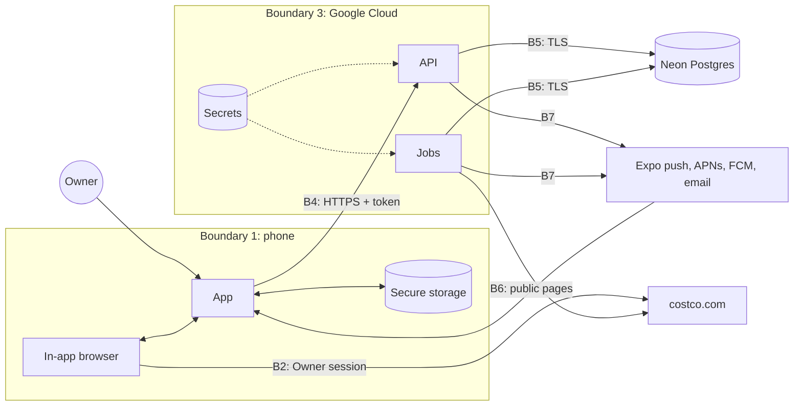

# Costco Price Match App — Threat Model

**Status:** Draft for review · **Phase:** 3, Design · **Last updated:** Oct 21, 2026

This threat model covers the Phase 1 design in the [architecture](architecture.md). It uses STRIDE (spoofing, tampering, repudiation, information disclosure, denial of service, elevation of privilege) against each trust boundary, and maps every mitigation to a requirement in the [requirements specification](../requirements.md). It is reviewed again at the end of Implementation and before Phase 2.

## 1. Assets

| ID | Asset | Where it lives | Why it matters |
| --- | --- | --- | --- |
| A1 | Costco session cookies | Phone secure storage only | Full access to the Owner's Costco account, including order history and saved details |
| A2 | Costco password | Typed only into Costco's own page; never stored | Same as A1, plus reuse on other sites |
| A3 | App access and refresh tokens | Phone secure storage; refresh-token hashes on the server | Access to all of the Owner's app data |
| A4 | Purchase history (items, prices, dates, warehouse number) | Server database, phone cache | Reveals shopping habits and the warehouse the Owner visits |
| A5 | App account password | Argon2id hash on the server | Account takeover |
| A6 | Push tokens and alert email address | Server database | Spam or phishing to the Owner |
| A7 | Server secrets (database URL, token signing key, push and email keys) | Secret Manager | Full backend compromise |
| A8 | Integrity of prices, flags and claim amounts | Server database | A wrong claim card wastes a trip or makes a false claim at the counter |

## 2. Data flows and trust boundaries

| Boundary | Between | Crosses it |
| --- | --- | --- |
| B1 | The app and the rest of the phone (other apps, the OS, a person holding the phone) | Shared PDFs, notifications |
| B2 | The in-app browser and costco.com | Sign-in, the Owner's session, account pages |
| B3 | The app's JavaScript and content inside its WebViews | Messages from injected scripts and PDF.js |
| B4 | The phone and the API | Purchase fields, tokens, sync outcomes |
| B5 | The backend and the database | All server data |
| B6 | The price-check job and costco.com | Public page requests and responses |
| B7 | The backend and push or email providers | Minimal alert text, push tokens, email address |

## 3. Threats and mitigations

| ID | Where | STRIDE | Threat | Mitigation | Requirements | Residual |
| --- | --- | --- | --- | --- | --- | --- |
| T-01 | B2 sign-in | I | The app, a dependency or an injected script reads the Costco password as it is typed | No scripts injected on sign-in pages; WebView message handler disabled until sign-in completes; code review and network inspection test that no password reaches the API | NFR-01, FR-01 | Low |
| T-02 | B1 phone | I | Malware or a person with the unlocked phone extracts the Costco session or app tokens | Keychain / Keystore with "this device only" access; excluded from cloud backups; sign-out and disconnect wipe them | NFR-02, NFR-08, FR-02, FR-30 | Medium: a fully compromised phone defeats app-level controls |
| T-03 | B4 API | S | Someone calls the API as the Owner with a stolen access token | 15-minute access tokens; TLS only; tokens never logged | NFR-08, NFR-13 | Low |
| T-04 | B4 API | S | A stolen refresh token is replayed | Rotation with family revocation on reuse; hashes only on the server | NFR-08 | Low |
| T-05 | B4 API | S | Password guessing against `/auth/login` | Argon2id; lockout after 5 failures in 15 minutes; generic errors | NFR-09 | Low |
| T-06 | B4 API | E | One account reads or changes another account's records by guessing IDs (IDOR), relevant once Phase 2 adds users | Every query filtered by `user_id` in one data-access layer; two-account tests on every route; UUIDs | FR-28, NFR-10 | Low |
| T-07 | B4 API | T | Crafted request bodies cause injection or mass assignment (for example setting `automation_enabled` or a claim's `refund_due_cents`) | Pydantic models with explicit allowed fields; SQLAlchemy bound parameters; server recomputes all derived amounts | NFR-07, FR-31 | Low |
| T-08 | B3 WebView | T, E | A compromised or unexpected page inside the in-app browser posts fake receipt data or calls app functions | WebView navigation limited to an allowlist of costco.com paths; message handler accepts only a fixed schema from allowlisted origins; no native functions exposed; parsed values validated (types, ranges, item-number format) | NFR-07, NFR-23 | Low |
| T-09 | B1 / B3 PDF | T, D | A malicious PDF exploits the parser or hangs the app | PDF.js in a network-blocked WebView; type checked by content; 5 MB, 10 pages, 10 seconds; scripts and attachments never executed | NFR-05 | Low |
| T-10 | B4 upload | T | The phone uploads altered purchases (for example a higher price paid) | Phase 1 has one user, so this only affects the Owner's own records; server validates ranges and dates; Phase 2 adds rate limits and anomaly checks | NFR-07 | Accepted for Phase 1 |
| T-11 | B6 price check | T | A changed or spoofed Costco page leads to a wrong price and a false flag | TLS to an allowlisted host; versioned parser with fixture tests; implausible changes (for example over 90% off) held for review instead of alerted; claim card shows where and when the price was seen | NFR-23, FR-22 | Medium: the Owner should glance at the price before claiming |
| T-12 | B6 price check | E (SSRF) | A crafted item number makes the job fetch an internal or attacker-chosen URL | Item numbers validated as digits only; URLs built from a fixed template; outbound host allowlist; no redirects to other hosts | NFR-07 | Low |
| T-13 | B6 price check | D | Costco blocks the job's traffic or shows a bot check | Personal-use rates with backoff; the job stops at any challenge and raises a health alert; manual price entry stays available | NFR-21, FR-21 | Accepted (see section 5) |
| T-14 | B7 push | I | Notification banners on a locked screen reveal purchase details | Banner text limited to item, amount saved and claim deadline; no order or membership numbers | NFR-14 | Low |
| T-15 | B7 push | S | A forged push or email lures the Owner into a fake claim or sign-in page | Notifications only open screens inside the app; email alerts carry no sign-in links, only a deep link that opens the app; the app never asks for the Costco password outside Costco's sign-in page | NFR-14 | Low |
| T-16 | B5 database | I | A database or backup leak exposes purchase history | Provider encryption at rest; TLS; least-privilege database roles (the API can't drop tables); backups in a private bucket; no Costco session, card or membership numbers stored at all | NFR-04, NFR-11 | Medium: purchase history would be exposed |
| T-17 | B3 Cloud | E | A leaked secret or compromised CI pipeline gives control of the backend | Secrets only in Secret Manager; CI uses Workload Identity Federation instead of stored keys; secret scanning; branch protection on `main` | NFR-06 | Low |
| T-18 | Supply chain | T, E | A malicious npm or PyPI package, or Expo update, ships code into the app or API | Lockfiles; Dependabot and audit in CI; minimal dependencies; EAS Update channels signed with code signing | NFR-07 | Medium |
| T-19 | Logs | I | Logs or crash reports capture tokens, emails or receipt content | Redaction filter; error codes instead of page content; crash reporting configured to drop request bodies | NFR-13 | Low |
| T-20 | Audit | R | The Owner can't tell why an alert fired or whether a status change happened | Each flag records the observation that caused it, with source, parser version and time; `flag_events` keeps status history | FR-22, FR-24 | Low |
| T-21 | Repo | I | Real receipts, pages or personal data are committed to the public repo | Fixtures invented only; pre-commit PII and secret scans; `.gitignore` blocks receipt and data folders | NFR-12 | Low |

## 4. Abuse cases

- **Lost or stolen phone.** The attacker needs the phone passcode or biometrics to reach Keychain or Keystore items. The Owner revokes every refresh token on the server (a one-line admin command in Phase 1) and changes the Costco password, which ends the Costco session.
- **API server breach.** The attacker gets purchase history (T-16) but no Costco session, Costco password or card data, because none of them are ever on the server (design principle 1).
- **Phase 2 member signs up.** Automation stays off for the new account (FR-31), and IDOR protections (T-06) keep accounts apart.

## 5. Accepted risks

| Risk | Why it is accepted | Review point |
| --- | --- | --- |
| Costco ends the Owner's online access for automated use (Site Terms Sections 9 and 16) | The Owner's decision, recorded in the charter's terms of use section; limited to the Owner's own account at personal-use rates | Start of each phase |
| Costco changes its pages and breaks sync or price checks | Fallbacks and health alerts cover it; parsers are versioned and updatable over the air | Continuous |
| A fully compromised phone exposes the Costco session (T-02) | No app-level control defeats a rooted or jailbroken phone with the passcode | Phase 2 |
| Altered uploads from the Owner's own phone (T-10) | Single user in Phase 1 | Before Phase 2 sign-up |

## 6. Security testing

| Activity | When | Covers |
| --- | --- | --- |
| Unit and contract tests for auth, scoping, validation and upload schema | Every pull request | T-03 to T-07, T-12 |
| Parser fixture tests, including malformed and hostile inputs | Every pull request | T-08, T-09, T-11 |
| Secret, PII and dependency scans | Every pull request | T-17, T-18, T-21 |
| Network inspection of sign-in and sync with a proxy on a test phone | Once per release | T-01, NFR-04 |
| OWASP ASVS Level 1 and MASVS checklists | Testing phase | All |
