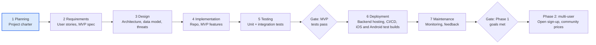

# Costco Price Match App — Project Charter

**Status:** Draft · **Phase:** Planning · **Last updated:** Oct 21, 2026

## Problem statement

Costco members leave money on the table because nobody tracks whether an item they bought drops in price during the adjustment window. Catching a drop today means remembering every purchase, its date and price, and checking sale flyers by hand before the window closes.

The app removes that manual work: it records purchases, watches the adjustment window for each item, and alerts the member when a price drop makes an adjustment claimable.

## Vision and product strategy

Ship a personal tool first, but build it on a multi-user foundation so other members can sign up later without a rewrite.

The product is a phone app for iOS and Android, built from one cross-platform codebase. A small backend API sits behind it to store purchases, run price checks and the alert schedule, and send notifications.

- **Phase 1 (personal):** one real user (the developer), real receipts, real alerts. This proves the core loop works.
- **Phase 2 (multi-user):** open sign-up to other members, add shared price reports, and harden security and privacy. Automated receipt sync and price checks are offered to other members, or monetized, only with Costco's written permission (see [Terms of use](#terms-of-use)); otherwise Phase 2 members use the fallbacks.

To keep that path open from day one, the design includes user accounts and authentication, scopes every record to a user ID, keeps business rules out of the UI, and stores secrets in configuration rather than code.

## Goals and success metrics

The project succeeds when it recovers real money with less effort than checking by hand. Targets are first drafts, to be revised after the first month of use.

| Goal | Metric | Phase 1 target |
| --- | --- | --- |
| Recover money | Dollars refunded through adjustments the app flagged | Tracked monthly; any recovered amount above zero |
| Low effort | Time to log one receipt | Under 2 minutes |
| Trustworthy alerts | Share of alerts that turn out claimable at the warehouse | At least 90% |
| No missed windows | Purchases whose window closes without a price check | 0 |
| Resume-ready | Public repo with README, tests, CI, a deployed backend, and installable iOS and Android test builds | Done by end of Phase 1 |

## Target users and stakeholders

The primary user is a Costco member who buys big-ticket or frequently discounted items and wants refunds without tracking flyers.

| Who | Role | What they need |
| --- | --- | --- |
| Developer (owner) | Builder, Phase 1 sole user | Working tool, portfolio evidence of full SDLC |
| Costco members (Phase 2) | End users | Simple receipt logging, timely alerts, privacy of purchase data |
| Costco membership counter staff | Indirect | Clear claim info at the counter: item number, purchase date, price paid |
| Hiring managers | Resume audience | Clean repo, documented decisions, tests, security thinking |

## Scope

The MVP makes tracking as close to effortless as possible. The member signs in to Costco once inside the app, on their own phone, and the app then syncs online and warehouse receipts from that session and checks current prices for every item still in its window. The member's Costco password is never stored by the app and never reaches its server. Sharing a receipt PDF and manual entry stay available for when the member prefers them or sync stops working.

| Feature | MVP (Phase 1) | Phase 2 | Out of scope |
| --- | --- | --- | --- |
| Automatic sync of online and warehouse receipts from the member's Costco account, through a sign-in on the member's phone | Yes (owner's own account, personal use) | Only with Costco's written permission |  |
| One-tap import of warehouse receipts: share the receipt PDF from the Costco app | Yes (fallback) |  |  |
| Alert when receipt sync or price checks stop working, or the Costco session expires | Yes |  |  |
| Auto-import online orders from forwarded Costco.com order confirmation emails |  | Yes (fallback); optional read-only Gmail connection (OAuth) |  |
| Import prompt triggered by a Costco charge on a linked card feed |  | Investigate |  |
| Manual purchase entry (item #, name, price, date, warehouse) | Yes (fallback) |  |  |
| Receipt photo with OCR for paper receipts |  | Yes |  |
| Countdown of days left per item's window | Yes |  |  |
| Automatic price checks for every item still in its window, online and in the Warehouse Savings listings | Yes (owner's own account, personal use) | Only with Costco's written permission |  |
| Manual entry of current sale price | Yes (fallback) |  |  |
| Alert when current price is below price paid, shown in the app and as a push notification banner | Yes (email as fallback) |  |  |
| iOS and Android app installed through TestFlight and Google Play internal testing | Yes |  |  |
| Public listing in the App Store and Google Play |  | Yes |  |
| "Claim card" with the details staff ask for | Yes |  |  |
| Log of claims made and dollars recovered | Yes |  |  |
| User accounts and authentication | Yes (single account) | Open sign-up |  |
| Community-reported sale prices |  | Yes |  |
| Monthly savings-book import |  | Investigate |  |
| Storing members' Costco passwords, or logging in to Costco from the app's server |  |  | Yes |
| Filing the adjustment on the member's behalf |  |  | Yes |
| Non-Costco retailers |  |  | Yes |

## Business rules

An item qualifies when Costco's own price for it drops within 30 days of the purchase date, subject to the rules below. They were checked against Costco's official price adjustment policy on Oct 21, 2026.

| ID | Rule | How the app applies it |
| --- | --- | --- |
| BR-1 | Purchases that drop in price within 30 days of the purchase date are eligible | Countdown starts at the receipt date; online orders use the order date |
| BR-2 | Costco does not price match other businesses or retailers | Never compare against non-Costco prices |
| BR-3 | Costco does not price match warehouse prices for Costco.com purchases, because online prices include shipping and handling | Store a channel per purchase; compare only within the same channel (whether a warehouse purchase can use a lower online price is an open question in the requirements) |
| BR-4 | Costco.com purchases are claimed with the "Request a Price Match" form on Costco's customer service site; warehouse purchases at the Returns counter of the warehouse where the item was bought | Claim card shows the right path per channel, including the purchase warehouse |
| BR-5 | For items with specific sale dates, the request must be made within both the promotion dates and 30 days of purchase; requests after the promotion ends may be denied | Claim deadline is the earlier of the promotion end date and the end of the 30-day window; alerts and the claim card show it |
| BR-6 | Precious metals are not eligible for price matches or promotions. Resellers are not eligible and must buy during promotion dates to get promotional prices. Special Order Kiosk and Home Improvement installed products follow separate promotion rules. Tires and wheels qualify under the normal rules | Exclusions list in config, starting with precious metals and Special Order Kiosk and Home Improvement installed products; the owner is a non-reseller member |
| BR-7 | Costco can deny requests at its sole discretion and may restrict the policy, with restrictions shown at the point of purchase | Keep the window length and rules in config, not code |
| BR-8 | Approved Costco.com credits are typically issued within 5 to 10 business days to the original form of payment | Track claim status: flagged, claimed, refunded |
| BR-9 | Products with promotional item limits are eligible only up to the limit quantity | Refund due uses the lesser of the quantity bought and the limit |

Source: Costco customer service, [Price Adjustment - Costco.com Orders](https://customerservice.costco.com/app/answers/detail/a_id/628) (policy text confirmed by the owner, Oct 21, 2026); online and warehouse price differences: [Costco customer service article 691](https://customerservice.costco.com/app/answers/answer_view/a_id/691).

## Data sources and feasibility

Costco has no public API for purchases or prices, so the MVP reads the member's own order and receipt history through a sign-in on the member's phone, and checks Costco's product pages for current prices. Both depend on Costco's site staying the same, and Costco's Site Terms prohibit this kind of automated access without written consent (see [Terms of use](#terms-of-use)), so automation is limited to the owner's own account for personal use, and each stream keeps a fallback the member controls: shared receipt PDFs and manual entry for purchases, and manual entry for prices.

| Data | Option | Effort | Reliability | Terms risk | Decision |
| --- | --- | --- | --- | --- | --- |
| Online and warehouse purchases | Sync from the member's Costco account through a sign-in on the member's phone | Medium | Medium (breaks when Costco changes its site) | High; prohibited by Site Terms Section 9 without written consent | MVP (owner's own account, personal use) |
| Online purchases | Forwarded Costco.com order confirmation emails | Low | High | None | Phase 2 fallback |
| Warehouse purchases | Receipt PDF shared from the Costco app | Low | High (structured PDF) | None | MVP fallback |
| Any purchase | Manual entry | Low | High | None | MVP fallback |
| Paper receipts | Receipt photo + OCR | Medium | Medium (receipt abbreviations) | None | Phase 2 |
| Purchase trigger | Card transaction feed (aggregator such as Plaid) to prompt an import | Medium | High for the trigger; no line items | None, but adds sensitive financial data | Phase 2 investigation |
| Any purchase | Browser extension reading the member's own logged-in session | Medium | Low (breaks on site changes) | Medium | Not needed (replaced by sync on the phone) |
| Any purchase | App's server logs into the member's Costco account with stored credentials | High | Low (MFA, bot detection) | High; server holds every member's password | Out of scope |
| Current prices | Automatic checks of Costco's product pages and Warehouse Savings listings for items still in their window | Medium | Medium (item numbers may differ between channels) | High; prohibited by Site Terms Section 9 without written consent | MVP (owner's own account, personal use) |
| Current prices | Manual entry when a sale is spotted | Low | High | None | MVP fallback |
| Current prices | Monthly savings book from public listings | Medium | Medium | Check source terms | Phase 2 investigation |
| Current prices | Community reports from other users | Medium | Medium (needs moderation) | None | Phase 2 |

Open question: which public sources of Costco sale prices allow reuse, and in what format?

## Terms of use

Costco's [Site Terms](https://www.costco.com/f/-/terms-and-conditions-of-use) (last updated Oct 7, 2026) were reviewed on Oct 21, 2026. This is a summary for planning, not legal advice.

| Section | What it says | Effect on this project |
| --- | --- | --- |
| 4, License and Site Access | Personal use only; no commercial use of the Services or Site Materials without Costco's written permission | Automation can't be monetized without permission |
| 5, Accounts | Members may not share their account credentials or let others use them | A multi-user version can't have members sign in to Costco through this app without permission |
| 6, Trademarks | No use of Costco's trademarks without written permission | Generic app name, no logo, unaffiliated disclaimer |
| 9, Your Conduct | Prohibits data mining, robots or similar extraction methods; developing or using applications that interact with the Services without prior written consent; and bypassing measures that limit access | Receipt sync and automatic price checks conflict with this clause |
| 16, Termination | Costco may end a member's access to its site and apps without notice for violations | The owner's online account is at risk |

**Decision (Oct 21, 2026):** the owner accepts the risk and builds automated sync and price checks for the owner's own account and personal use only. In practice that means:

- automated sources stay off for any other account;
- automation is never monetized or offered to other members without Costco's written permission;
- request rates stay at personal-use levels;
- the app never bypasses access controls or bot checks.

The terms are rechecked at the start of each phase and before any sign-up or monetization.

## Risks and mitigations

The biggest risk is that automated access to Costco breaks or leads Costco to end the owner's online access, since its Site Terms prohibit it. Every automated stream therefore keeps a manual fallback, and automation stays limited to the owner's own account.

| Risk | Likelihood | Impact | Mitigation |
| --- | --- | --- | --- |
| Costco changes its site or blocks automated access, breaking sync or price checks | High | High | Pluggable purchase and price sources; versioned parsers with fixture tests; alert the member when sync stops; PDF sharing and manual entry as fallbacks; never bypass bot checks |
| Automated access conflicts with Costco's terms of use, risking the member's account or a takedown | High (confirmed in Site Terms Sections 4, 5 and 9) | High | Owner's own account and personal use only; personal-scale request rates; never bypass access controls; no server-side login; automated sources off for other accounts; recheck terms each phase; seek written permission before Phase 2 sign-up or monetization |
| Automatic price checks miss warehouse-only prices or can't match warehouse item numbers to online listings | High | Medium | Manual price entry fallback; investigate in Design |
| The Costco session stored on the phone is stolen or misused | Low | High | Session kept only in the phone's secure storage (Keychain or Keystore); password never stored or sent to the server; signing out clears it |
| Spoofed or malicious inbound emails and PDFs | Medium | High | Accept mail only from the member's registered address and verify the Costco sender (DKIM); parse PDFs in a sandbox with size and type limits; never render untrusted HTML |
| Costco changes its email or receipt PDF format | Medium | Medium | Versioned parsers with fixture tests (fake data only); flag unparsed imports and fall back to manual entry |
| Receipt data leaks (purchase history, warehouse location) | Medium | High | Least-privilege access, encryption at rest, no card data stored, threat model in Design |
| Costco changes the policy | Medium | Medium | Rules in config; review policy each quarter |
| OCR misreads item numbers or prices (Phase 2) | High | Medium | User confirms every OCR field before saving |
| Using the Costco name or logo implies endorsement | Medium | Medium | Generic app name; no Costco logo; disclaimer that it's unaffiliated (Site Terms Section 6) |
| App store review rejects the app or its use of the Costco name | Medium | Medium | Phase 1 ships through test tracks only; generic name, no Costco logo, accurate privacy labels before any public listing |
| Purchase details appear in lock-screen notifications | Medium | Low | Notifications carry only the item and the amount saved; details load after the app opens |
| Scope creep delays a usable MVP | Medium | Medium | Hold the MVP list; new ideas go to a Phase 2 backlog |

## Assumptions and constraints

**Assumptions**

- The member is willing to sign in to Costco once inside the app, and to sign in again when Costco ends the session.
- The owner is a non-reseller member, so the reseller restrictions in BR-6 don't apply in Phase 1.
- Users keep their receipts, paper or digital, and can read item numbers and prices from them.
- An alert within a day of a sale being entered is fast enough to claim before the sale ends.
- The developer is the only user until Phase 1 is complete.

**Constraints**

- Part-time build alongside a full-time job; scope sized to evenings and weekends.
- Low or zero hosting cost during Phase 1, plus app store developer account fees.
- No storage of payment card numbers or Costco passwords; the Costco session stays on the member's phone.
- The product is an iOS and Android app from one cross-platform codebase, plus a backend API. The mobile framework and stack are decided in the Design phase; Python is the likely backend language.

## Milestones

Planning is the current phase; Requirements starts once this charter is approved. Dates are set after the requirements are sized.

The MVP ships only after its tests pass, and multi-user work starts only once the Phase 1 success metrics are met.
