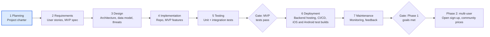

# Costco Price Match App — Project Charter

**Status:** Draft · **Phase:** Planning · **Last updated:** Oct 20, 2026

## Problem statement

Costco members leave money on the table because nobody tracks whether an item they bought drops in price during the adjustment window. Catching a drop today means remembering every purchase, its date and price, and checking sale flyers by hand before the window closes.

The app removes that manual work: it records purchases, watches the adjustment window for each item, and alerts the member when a price drop makes an adjustment claimable.

## Vision and product strategy

Ship a personal tool first, but build it on a multi-user foundation so other members can sign up later without a rewrite.

The product is a phone app for iOS and Android, built from one cross-platform codebase. A small backend API sits behind it to receive forwarded order emails, run the alert schedule, and send notifications.

- **Phase 1 (personal):** one real user (the developer), real receipts, real alerts. This proves the core loop works.
- **Phase 2 (multi-user):** open sign-up to other members, add shared price reports, and harden security and privacy.

To keep that path open from day one, the design includes user accounts and authentication, scopes every record to a user ID, keeps business rules out of the UI, and stores secrets in configuration rather than code.

## Goals and success metrics

The project succeeds when it recovers real money with less effort than checking by hand. Targets are first drafts, to be revised after the first month of use.

| Goal | Metric | Phase 1 target |
| --- | --- | --- |
| Recover money | Dollars refunded through adjustments the app flagged | Tracked monthly; any recovered amount above zero |
| Low effort | Time to log one receipt | Under 2 minutes |
| Trustworthy alerts | Share of alerts that turn out claimable at the warehouse | At least 90% |
| No missed windows | Purchases whose window closes without a price check | 0 |
| Resume-ready | Public repo with README, tests, CI, a deployed backend, and installable iOS and Android test builds | Done by end of Phase 1 |

## Target users and stakeholders

The primary user is a Costco member who buys big-ticket or frequently discounted items and wants refunds without tracking flyers.

| Who | Role | What they need |
| --- | --- | --- |
| Developer (owner) | Builder, Phase 1 sole user | Working tool, portfolio evidence of full SDLC |
| Costco members (Phase 2) | End users | Simple receipt logging, timely alerts, privacy of purchase data |
| Costco membership counter staff | Indirect | Clear claim info at the counter: item number, purchase date, price paid |
| Hiring managers | Resume audience | Clean repo, documented decisions, tests, security thinking |

## Scope

The MVP imports purchases with as little effort as Costco's data allows: automatically for online orders, in one tap for warehouse receipts. It then tracks each item's window, takes current prices, and alerts on drops. The app never logs into a member's Costco account or stores Costco credentials.

| Feature | MVP (Phase 1) | Phase 2 | Out of scope |
| --- | --- | --- | --- |
| Auto-import online orders from Costco.com order confirmation emails, via a forwarding rule to the app's inbound address | Yes | Optional read-only Gmail connection (OAuth) |  |
| One-tap import of warehouse receipts: share the receipt PDF from the Costco app | Yes |  |  |
| Reminder to import a warehouse receipt once it's available in the Costco app | Yes (scheduled reminder) | Triggered by a Costco charge on a linked card feed |  |
| Manual purchase entry (item #, name, price, date, warehouse) | Yes (fallback) |  |  |
| Receipt photo with OCR for paper receipts |  | Yes |  |
| Countdown of days left per item's window | Yes |  |  |
| Manual entry of current sale price | Yes |  |  |
| Alert when current price is below price paid | Yes (push notification, with email as fallback) |  |  |
| iOS and Android app installed through TestFlight and Google Play internal testing | Yes |  |  |
| Public listing in the App Store and Google Play |  | Yes |  |
| "Claim card" with the details staff ask for | Yes |  |  |
| Log of claims made and dollars recovered | Yes |  |  |
| User accounts and authentication | Yes (single account) | Open sign-up |  |
| Community-reported sale prices |  | Yes |  |
| Monthly savings-book import |  | Investigate |  |
| Logging into a member's Costco account, storing Costco credentials, or scraping costco.com |  |  | Yes |
| Filing the adjustment on the member's behalf |  |  | Yes |
| Non-Costco retailers |  |  | Yes |

## Business rules

An item qualifies when Costco's own price for it, in the same channel, drops within 30 days of the purchase date. These rules come from secondary sources and must be checked against Costco's official policy page before design starts.

| ID | Rule | How the app applies it |
| --- | --- | --- |
| BR-1 | Window is 30 days from the purchase date, not the delivery date | Countdown starts at the receipt date; online orders use the order date |
| BR-2 | Only Costco's own lower price counts; no matching other retailers | Never compare against non-Costco prices |
| BR-3 | Warehouse and online prices are separate channels | Store a channel per purchase; compare only within the same channel |
| BR-4 | Warehouse claims go to the warehouse counter; online claims use Costco.com's request form | Claim card shows the right path per channel |
| BR-5 | Members have reported claims refused once the sale had ended | Alert immediately and show the sale's end date when known |
| BR-6 | Some items are excluded (gold bullion is one example); resellers are excluded | Allow flagging an item as excluded; keep an exclusions list as config |
| BR-7 | Costco can deny adjustments at its discretion and may change the policy | Keep the window length and rules in config, not code |
| BR-8 | Approved online refunds land on the original payment method, typically in 5 to 10 business days | Track claim status: flagged, claimed, refunded |

Sources: [Tasting Table](https://www.tastingtable.com/1803125/does-costco-price-match/), [Hip2Save](https://hip2save.com/tips/costco-price-adjustment-policy/), [Chowhound](https://chowhound.com/1743913/track-costco-prices-after-purchase), [Slickdeals](https://daily.slickdeals.net/tech/costco-price-adjustment-policy/).

## Data sources and feasibility

The project is feasible if every data stream reaches the app through something the member already receives or can export, never through the app logging into Costco. Costco has no public API for purchases or prices. Online orders produce an order confirmation email, so they can import automatically. Warehouse receipts appear in the member's Costco app within about a day but aren't emailed, so the member shares them into the app.

| Data | Option | Effort | Reliability | Terms risk | Decision |
| --- | --- | --- | --- | --- | --- |
| Online purchases | Forwarded Costco.com order confirmation emails | Low | High | None | MVP |
| Warehouse purchases | Receipt PDF shared from the Costco app | Low | High (structured PDF) | None | MVP |
| Any purchase | Manual entry | Low | High | None | MVP fallback |
| Paper receipts | Receipt photo + OCR | Medium | Medium (receipt abbreviations) | None | Phase 2 |
| Purchase trigger | Card transaction feed (aggregator such as Plaid) to prompt an import | Medium | High for the trigger; no line items | None, but adds sensitive financial data | Phase 2 investigation |
| Any purchase | Browser extension reading the member's own logged-in session | Medium | Low (breaks on site changes) | Medium | Phase 2 investigation |
| Any purchase | App logs into the member's Costco account | High | Low (MFA, bot detection) | High; requires storing credentials | Out of scope |
| Current prices | Manual entry when a sale is spotted | Low | High | None | MVP |
| Current prices | Monthly savings book from public listings | Medium | Medium | Check source terms | Phase 2 investigation |
| Current prices | Community reports from other users | Medium | Medium (needs moderation) | None | Phase 2 |
| Current prices | Scraping costco.com | High | Low | High | Out of scope |

Open question: which public sources of Costco sale prices allow reuse, and in what format?

## Risks and mitigations

The biggest risk is price data: without a reliable, permitted source, alerts depend on users spotting sales themselves.

| Risk | Likelihood | Impact | Mitigation |
| --- | --- | --- | --- |
| No permitted automated price source | High | High | Manual and community entry first; design a pluggable price-source interface |
| Holding members' Costco credentials | Low (excluded) | High | Out of scope by decision: no Costco login, no stored Costco passwords, no scraping |
| Spoofed or malicious inbound emails and PDFs | Medium | High | Accept mail only from the member's registered address and verify the Costco sender (DKIM); parse PDFs in a sandbox with size and type limits; never render untrusted HTML |
| Costco changes its email or receipt PDF format | Medium | Medium | Versioned parsers with fixture tests (fake data only); flag unparsed imports and fall back to manual entry |
| Receipt data leaks (purchase history, warehouse location) | Medium | High | Least-privilege access, encryption at rest, no card data stored, threat model in Design |
| Costco changes the policy | Medium | Medium | Rules in config; review policy each quarter |
| OCR misreads item numbers or prices (Phase 2) | High | Medium | User confirms every OCR field before saving |
| Using the Costco name or logo implies endorsement | Medium | Medium | Generic app name; disclaimer that it's unaffiliated |
| App store review rejects the app or its use of the Costco name | Medium | Medium | Phase 1 ships through test tracks only; generic name, no Costco logo, accurate privacy labels before any public listing |
| Purchase details appear in lock-screen notifications | Medium | Low | Notifications carry only the item and the amount saved; details load after the app opens |
| Scope creep delays a usable MVP | Medium | Medium | Hold the MVP list; new ideas go to a Phase 2 backlog |

## Assumptions and constraints

**Assumptions**

- Users keep their receipts, paper or digital, and can read item numbers and prices from them.
- An alert within a day of a sale being entered is fast enough to claim before the sale ends.
- The developer is the only user until Phase 1 is complete.

**Constraints**

- Part-time build alongside a full-time job; scope sized to evenings and weekends.
- Low or zero hosting cost during Phase 1, plus app store developer account fees.
- No storage of payment card numbers or Costco account credentials.
- The product is an iOS and Android app from one cross-platform codebase, plus a backend API. The mobile framework and stack are decided in the Design phase; Python is the likely backend language.

## Milestones

Planning is the current phase; Requirements starts once this charter is approved. Dates are set after the requirements are sized.

The MVP ships only after its tests pass, and multi-user work starts only once the Phase 1 success metrics are met.
